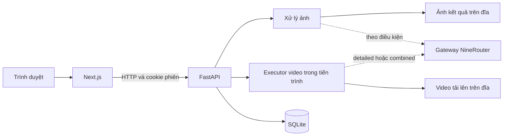

# Kiến trúc và cấu trúc dự án

Cập nhật theo working tree ngày 19/11/2026. Tài liệu này mô tả module, API và dữ liệu; [README](README.md) giữ hướng dẫn cài đặt/khởi động. Bố trí dưới đây đã được cập nhật ở giai đoạn 2; các snapshot kiểm toán trước đó giữ nội dung lịch sử.

## Kiến trúc triển khai

Backend là **modular monolith**: API, model AI, kết nối database và executor video nằm trong cùng ứng dụng FastAPI. Frontend Next.js chạy ở tiến trình riêng và gọi HTTP API. Database hiện được kiểm tra là SQLite; khả năng vận hành PostgreSQL và nhiều worker phân tán chưa được kiểm chứng.

Frontend khai báo Next.js 16.4.5 và React/React DOM 19.3.0 trong `frontend/package.json`. Backend khai báo dependency trong `requirements.txt`; nhiều package dùng giới hạn `>=`, nên phiên bản cài ở máy khác có thể khác. Snapshot phiên bản đã kiểm tra nằm trong [AUDIT.md](AUDIT.md).



`_inference_lock` tuần tự hóa các đoạn suy luận được bảo vệ. Video sử dụng `ThreadPoolExecutor(max_workers=1)` và giới hạn tối đa hai job ở trạng thái queued/running. Thông tin job nằm trong bộ nhớ; chưa có cơ chế lưu/khôi phục job qua lần khởi động backend. Các giới hạn này không phải bằng chứng tải nhiều camera hoặc xử lý thời gian thực.

## Bố trí file hiện tại

```text
main.py                     Khởi tạo FastAPI, lifespan, CORS, router, ảnh kết quả có bảo vệ
src/
  config.py                 Settings từ môi trường và .env
  api/
    auth.py                 Đăng ký/đăng nhập, cookie phiên, giới hạn thử xác thực
    routes.py               Điều phối nhận diện ảnh, ghi và truy vấn lịch sử
    schemas.py              Schema kết quả ảnh
    video_routes.py         Upload video, executor, trạng thái job và media
  core/
    detector.py             Nạp YOLO và lọc/cắt vùng biển số
    ocr_engine.py           YOLO OCR ảnh và các nhánh bổ trợ
    line_ocr.py             EasyOCR dòng, nạp khi cần và có trọng số cục bộ
    preprocessor.py         Tiền xử lý, nắn nghiêng, tách dòng
    postprocessor.py        Chuẩn hóa và kiểm tra định dạng biển
    plate_regions.py        Tạo vùng ứng viên biển số bằng hình học
    ninerouter_vision.py     HTTP client cho dịch vụ Vision qua gateway
    plate_reader.py         Lõi đọc biển số được tích hợp từ nguồn bên ngoài
    video_models.py         Factory detector/OCR video và adapter PlateReader
    video_ocr.yaml          Cấu hình OCR đi kèm bộ model video
    video_tracker.py        Theo vết phương tiện, ghép biển, tổng hợp các lượt đọc
  db/
    session.py              SQLAlchemy engine/session
    models.py               ORM tài khoản, phiên, thử xác thực và lịch sử ảnh
    migrations.py           Tạo schema, bổ sung owner_id và index
  evaluation/metrics.py     Metric detection, nội dung biển và thời gian
  utils/                    Log và vẽ annotation
frontend/
  src/app/                  /, /login, /register, /history, /video
  src/components/           Form, phiên đăng nhập, điều hướng, annotation video
  src/lib/                  HTTP fetch và thông tin biển Việt Nam
  src/types/                Kiểu dữ liệu API và video
scripts/                    Cài model, benchmark, hồi quy và runner notebook
benchmark/                  Bộ Playwright và tài liệu đánh giá
notebooks/                  Notebook phân tích và module hỗ trợ
models/                     Hướng dẫn và trọng số cục bộ
  video/                    Trọng số/cấu hình video được cài riêng
  yolov8n.pt                Trọng số phương tiện, giữ cục bộ
  checksums.txt             SHA256 các trọng số hiện có
data/                       Chỉ dữ liệu runtime cục bộ, toàn bộ bị ignore
tests/                      Test tài khoản, xử lý ảnh/video, metric và notebook
  fixtures/test_cases/      Ảnh tổng hợp có nhãn được giữ trong Git
docs/                       Tài liệu chuyên đề, trạng thái báo cáo và kết quả kiểm tra
  data.md                   Chính sách dữ liệu runtime và fixture
  tools/                    Phạm vi công cụ tài liệu, tách khỏi script kỹ thuật
pytest.ini                  Giới hạn test discovery vào tests/
Dockerfile                  Build backend
docker-compose.yml          Cấu hình backend/frontend và volume cục bộ
```

`handoff_unpushed/`, `external/` và `.local_archive/` là bản sao/tài liệu cục bộ được ignore; không thuộc runtime của ứng dụng. `tool/` không còn tồn tại. Không có pipeline `training/` trong cấu trúc hiện tại. Hướng dẫn nguồn model nằm tại [tài liệu video](docs/video_onnx.md#nguon-ma-va-model).

## Hai luồng nhận diện

| Luồng | Thành phần chính | Nhánh bổ trợ |
|---|---|---|
| Ảnh qua `/api/license-plates/detect` | Detector `models/best.pt`, OCR ký tự `models/LP_ocr.pt`, chuẩn hóa biển Việt Nam | Vùng ứng viên hình học, OCR dòng EasyOCR; NineRouter nếu cấu hình cho phép và local chưa có biển hợp lệ |
| Video qua API, mode `fast` | `models/yolov8n.pt` + ByteTrack theo vết phương tiện; `DetectLisence_YOLO11.pt` phát hiện biển; CCT ONNX đọc ký tự | Retry crop/đọc theo code tracker; không gọi OCR từ xa qua API ở mode này |
| Video qua API, mode `detailed`/`combined` | Dùng detector/OCR ảnh qua factory; `combined` chạy hai lượt fast/detailed rồi gộp | Có thể dùng NineRouter theo cấu hình và điều kiện tracker |

Luồng video mặc định có `VIDEO_ENGINE=onnx`; `legacy` chọn bộ detector/OCR ảnh cho mode fast. Tên mode và engine là hai lựa chọn khác nhau. Chi tiết nạp model/cấu hình, lấy mẫu và giới hạn đầu vào nằm trong [tài liệu video](docs/video_onnx.md).

`PlateReader` chứa cả xử lý frame/ByteTrack và bỏ phiếu ký tự từ mã kế thừa, nhưng web hiện dùng phần OCR qua `VideoPlateOCR`; bộ theo vết phương tiện/tổng hợp kết quả của web nằm trong `video_tracker.py`. Không mô tả mọi phương thức trong lớp kế thừa là đều được gọi trong pipeline mặc định.

Luồng ảnh hiện được điều phối trong route, chưa có tầng `src/services/` riêng. `PlateOCREngine.recognize_plate()` còn có các nhánh truyền thống/remote; thứ tự xử lý của method đó không thay thế thứ tự local trước của route ảnh. Điều kiện và dữ liệu gửi ra ngoài được mô tả tại [docs/cloud_ocr.md](docs/cloud_ocr.md).

## API hiện hành

Danh sách dưới đây đối chiếu từ `main.app.openapi()`; không dùng tiền tố phiên bản API.

| Method | Endpoint | Quyền truy cập |
|---|---|---|
| GET | `/` | Công khai; trạng thái backend |
| POST | `/api/auth/register` | Công khai; có giới hạn thử |
| POST | `/api/auth/login` | Công khai; có giới hạn thử |
| GET | `/api/auth/me` | Có phiên hợp lệ |
| POST | `/api/auth/logout` | Xóa phiên cookie nếu có |
| POST | `/api/license-plates/detect` | Có phiên hợp lệ |
| GET | `/api/license-plates/history` | Chỉ lịch sử thuộc tài khoản |
| GET | `/api/license-plates/search` | Chỉ lịch sử thuộc tài khoản |
| GET | `/api/license-plates/{detection_id}` | Chỉ bản ghi thuộc tài khoản |
| POST | `/api/video-tracking/jobs` | Có phiên hợp lệ |
| GET | `/api/video-tracking/jobs/{job_id}` | Chủ sở hữu job |
| GET | `/api/video-tracking/jobs/{job_id}/media` | Chủ sở hữu job |

Ngoài schema OpenAPI, `GET /static/{category}/{filename}` kiểm tra bản ghi ảnh thuộc tài khoản trước khi trả file. Tài liệu API được phục vụ tại `/docs`, `/redoc`, schema tại `/openapi.json`.

Lịch sử và tìm kiếm hỗ trợ `page`, `page_size`; tìm kiếm nhận query `plate`. Chưa có API quản trị người dùng, xuất/xóa lịch sử, reset mật khẩu hoặc RTSP/camera trực tiếp.

## Xác thực và database

`src/api/auth.py` băm mật khẩu bằng **scrypt** với salt ngẫu nhiên. Đăng nhập tạo token opaque ngẫu nhiên; trình duyệt giữ cookie `platesight_session`, database lưu SHA256 của token và thời điểm hết hạn. Cookie có HttpOnly, SameSite=Lax; Secure bật theo cấu hình hoặc môi trường production. Frontend gửi cookie qua fetch với `credentials: "include"` và lấy trạng thái từ `/api/auth/me`.

Quyền dữ liệu được kiểm tra theo người sở hữu. ORM không có cột role hay quyền Admin/Guest. Người chưa có phiên chỉ có thể dùng các chức năng công khai. Code không seed tài khoản mặc định; người dùng mới đăng ký qua ứng dụng.

| Model ORM | Bảng | Các cột |
|---|---|---|
| `User` | `users` | `id`, `name`, `email`, `password_hash`, `created_at` |
| `UserSession` | `user_sessions` | `token_hash`, `user_id`, `expires_at` |
| `AuthAttempt` | `auth_attempts` | `id`, `key`, `created_at` |
| `PlateHistory` | `plate_history` | `id`, `owner_id`, `plate_number`, `confidence`, `plate_type`, `engine_used`, `cropped_plate_url`, `annotated_image_url`, `created_at` |

SQLite mặc định ở `data/alpr.db`; `DATABASE_URL` có thể thay đổi. `migrations.py` thực hiện khởi tạo schema và bổ sung trường/index theo code, không seed dữ liệu. Job video nằm trong bộ nhớ; video tải lên lưu tại `data/video_jobs/`. Media trả về là file tải lên, frontend vẽ annotation từ metadata, không phải video đã render sẵn khung nhận diện.

## Giới hạn bằng chứng

Tập ảnh kèm repository hiện có 40 ảnh tổng hợp; không đại diện chất lượng trên giao thông thực tế. Các file biểu đồ có sẵn và số lượt đọc đúng định dạng không tự chứng minh độ chính xác. Chưa có số đo hiện tại về tải đồng thời lớn, MOTA/IDF1, ablation hoặc vận hành production.

Hướng dẫn đo và nguồn kết quả: [tests/TESTING.md](tests/TESTING.md), [benchmark/ACCURACY.md](benchmark/ACCURACY.md), [kết quả dọn repository](docs/results/repository_cleanup.md). [AUDIT.md](AUDIT.md) giữ nguyên snapshot trước đồng bộ để tra lại các sai lệch đã phát hiện.
