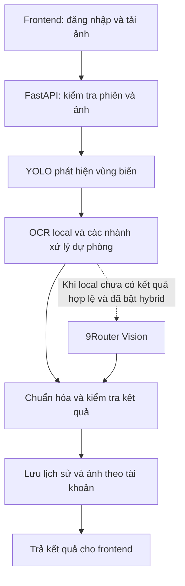

# Hệ thống nhận diện biển số xe Việt Nam

Ứng dụng web nhận diện biển số từ ảnh phương tiện: phát hiện vùng biển, đọc ký tự, hiển thị ảnh kết quả và lưu lịch sử theo tài khoản. Backend FastAPI, frontend Next.js.

**Quy ước đường dẫn:** mọi đường dẫn tính từ **thư mục gốc repository** (nơi chứa `main.py`). `localhost` là địa chỉ máy đang chạy ứng dụng.

---

## 1. Chức năng

- Đăng ký, đăng nhập và đăng xuất bằng email/mật khẩu.
- Tải ảnh lên (tối đa 10 MB) để phát hiện và đọc một hoặc nhiều biển số.
- Hiển thị chuỗi nhận diện, điểm tin cậy, ảnh cắt biển số và ảnh đánh dấu kết quả.
- Xem lịch sử, tìm kiếm và xem chi tiết kết quả theo tài khoản.
- OCR local bằng YOLO; hỗ trợ dự phòng EasyOCR và dịch vụ Vision qua 9Router.

> Điểm tin cậy không bảo đảm mọi ký tự đều chính xác. Ảnh mờ, nhiễu, biển quá nhỏ hoặc che khuất có thể đọc sai.

---

## 2. Công nghệ

| Thành phần | Công nghệ |
|---|---|
| Frontend | Next.js 16, React 19, TypeScript, Tailwind CSS 4 |
| Backend | FastAPI, Uvicorn, Pydantic |
| Phát hiện biển số | Ultralytics YOLO — `models/best.pt` |
| OCR chính | YOLO nhận dạng ký tự — `models/LP_ocr.pt` |
| Xử lý ảnh | OpenCV: tăng tương phản, căn chỉnh góc nghiêng |
| OCR dự phòng | EasyOCR — `models/easyocr/english_g2.pth` |
| Vision tùy chọn | 9Router kết nối model do người dùng cấu hình |
| Database | SQLite qua SQLAlchemy — `data/alpr.db` |
| Tài khoản | Mật khẩu băm scrypt, phiên đăng nhập qua cookie HttpOnly |



---

## 3. Cấu trúc thư mục

```text
license_plate_recognition/
├── frontend/                       # Giao diện Next.js
│   ├── src/app/                    # Nhận diện, đăng nhập, đăng ký, lịch sử
│   ├── src/components/             # Thành phần giao diện dùng chung
│   └── src/lib/                    # Hàm gọi API và xử lý phản hồi
├── src/
│   ├── api/                        # API nhận diện, tài khoản và schema
│   ├── core/                       # Detector, OCR, tiền/hậu xử lý ảnh
│   ├── db/                         # Bảng dữ liệu, kết nối và migration
│   ├── evaluation/                 # Hàm tính metric từ dự đoán
│   ├── utils/                      # Log và vẽ kết quả
│   └── config.py                   # Đọc cấu hình môi trường
├── models/                         # Trọng số mô hình (không theo dõi bởi Git)
├── data/                           # Dữ liệu, kết quả và database
├── notebooks/                      # Khám phá dữ liệu và thực nghiệm
├── tool/                           # Benchmark, notebook runner và thiết lập model
├── tests/                          # Kiểm thử tự động
├── docs/                           # Tài liệu dự án
├── .env.example                    # Tham khảo các biến môi trường
├── requirements.txt
├── main.py                         # Entrypoint backend
└── README.md
```

Trọng số, database và thư mục kết quả không được Git theo dõi. Sau khi clone, cần cung cấp model tương ứng.

---

## 4. Cài đặt

**Yêu cầu:** Python 3.13, Node.js ≥ 20.9, npm, và các trọng số model của dự án.

### 4.1. Cài thư viện

Các ví dụ dùng **Windows PowerShell** — gọi trực tiếp Python trong môi trường ảo:

```powershell
python -m venv venv
.\venv\Scripts\python.exe -m pip install -r requirements.txt
npm --prefix frontend ci
```

Trên Linux/macOS, thay `.\\venv\\Scripts\\python.exe` bằng `./venv/bin/python`.

### 4.2. Trọng số mô hình

| Tệp | Mục đích | Yêu cầu |
|---|---|---|
| `models/best.pt` | Phát hiện biển số | Bắt buộc |
| `models/LP_ocr.pt` | Nhận dạng ký tự | Bắt buộc |
| `models/easyocr/english_g2.pth` | OCR dòng dự phòng | Tùy chọn |

Lấy `best.pt` và `LP_ocr.pt` từ bộ trọng số của dự án và đặt đúng vị trí. Để cài model EasyOCR dự phòng:

```powershell
.\venv\Scripts\python.exe tool/setup_ocr.py --download
```

### 4.3. Cấu hình backend

Tạo `.env` tại thư mục gốc (xem `.env.example` để tham khảo). Cấu hình tối thiểu cho local:

```dotenv
APP_ENV=development
API_HOST=127.0.0.1
API_PORT=8000
OCR_ENGINE=yolo
YOLO_MODEL_PATH=models/best.pt
DATABASE_URL=sqlite:///data/alpr.db
OUTPUT_DIR=data/outputs
CORS_ORIGINS=http://localhost:3000,http://127.0.0.1:3000
AUTH_COOKIE_SECURE=false
```

Để dùng chế độ hybrid với 9Router, thêm:

```dotenv
OCR_ENGINE=hybrid
NINEROUTER_BASE_URL=http://localhost:20128/v1
NINEROUTER_API_KEY=YOUR_API_KEY
NINEROUTER_MODEL=YOUR_MODEL_ID
```

### 4.4. Cấu hình frontend

Tạo `frontend/.env.local` nếu cần đổi địa chỉ backend (mặc định `http://localhost:8000`):

```dotenv
NEXT_PUBLIC_API_URL=http://localhost:8000
```

Khi đổi cổng frontend, cập nhật `CORS_ORIGINS` trong `.env` backend và khởi động lại dịch vụ.

---

## 5. Khởi chạy

Mở **hai terminal tại thư mục gốc**:

```powershell
# Terminal 1 — backend
.\venv\Scripts\python.exe main.py

# Terminal 2 — frontend
npm --prefix frontend run dev -- --port 3000
```

| Địa chỉ | Công dụng |
|---|---|
| [http://localhost:3000](http://localhost:3000) | Giao diện web |
| [http://localhost:8000/docs](http://localhost:8000/docs) | Swagger UI |
| [http://localhost:8000/redoc](http://localhost:8000/redoc) | ReDoc |

**Sử dụng:** Đăng ký tài khoản → chọn ảnh phương tiện → nhận diện → kiểm tra kết quả và lịch sử.

> API nhận diện, lịch sử và ảnh kết quả yêu cầu đăng nhập. Chưa có chức năng xác minh email hoặc khôi phục mật khẩu.

---

## 6. API chính

| Phương thức | Endpoint | Chức năng |
|---|---|---|
| `GET` | `/` | Trạng thái backend |
| `POST` | `/api/auth/register` | Tạo tài khoản và phiên đăng nhập |
| `POST` | `/api/auth/login` | Đăng nhập |
| `GET` | `/api/auth/me` | Thông tin tài khoản hiện tại |
| `POST` | `/api/auth/logout` | Đăng xuất |
| `POST` | `/api/license-plates/detect` | Nhận diện — `multipart/form-data`, trường `file` |
| `GET` | `/api/license-plates/history?page=1&page_size=20` | Lịch sử cá nhân |
| `GET` | `/api/license-plates/search?plate=29A` | Tìm theo chuỗi biển số |
| `GET` | `/api/license-plates/{detection_id}` | Chi tiết kết quả |

Frontend gửi cookie với `credentials: include`. Xem kiểu request/response chi tiết tại Swagger.

---

## 7. Kiểm thử và đánh giá

Hướng dẫn đầy đủ: **[`tests/TESTING.md`](tests/TESTING.md)**

Tóm tắt nhanh:

```powershell
# Kiểm thử tự động
.\venv\Scripts\python.exe -m unittest discover -s tests -v
npm --prefix frontend run lint && npm --prefix frontend run build

# Benchmark offline (cần ground_truth.json)
.\venv\Scripts\python.exe tool/benchmark.py --dataset-kind synthetic

# Kiểm thử hồi quy
.\venv\Scripts\python.exe tool/check_regression.py --label local_before --mode local --cases data/my_test_set/cases.json
```

---

## 8. Notebooks

Phục vụ thực nghiệm và phân tích; không cần chạy để khởi động web. Xem: [`notebooks/README.md`](notebooks/README.md).

```powershell
.\venv\Scripts\python.exe tool/run_notebooks.py          # kiểm tra định dạng
.\venv\Scripts\python.exe tool/run_notebooks.py --execute # chạy và lưu kết quả
```

---

## 9. Lỗi thường gặp

| Hiện tượng | Kiểm tra |
|---|---|
| Không mở được web | Terminal frontend đang chạy, cổng 3000 không bị chiếm |
| Web không kết nối backend | `NEXT_PUBLIC_API_URL`, cổng 8000, log backend |
| Đăng nhập xong vẫn bị yêu cầu đăng nhập | Cookie, cùng hostname, `CORS_ORIGINS`, `AUTH_COOKIE_SECURE=false` khi HTTP local |
| Backend chạy nhưng không nhận diện | Kiểm tra `models/best.pt`, `models/LP_ocr.pt` và log nạp model |
| Nhánh OCR dòng không hoạt động | Kiểm tra `models/easyocr/english_g2.pth` bằng `tool/setup_ocr.py` |
| Hybrid chậm hoặc timeout | Dịch vụ 9Router, model ID, thông tin truy cập; thử riêng chế độ `yolo` |
| Ảnh bị từ chối | Ảnh giải mã được, kích thước ≤ 10 MB |
| Đổi mã nhưng kết quả chưa thay đổi | Đúng tiến trình đang phục vụ, khởi động lại nếu không dùng chế độ reload |
| Notebook thiếu dữ liệu | Đọc ô cấu hình, cung cấp đúng ảnh/manifest/model/benchmark được tham chiếu |
