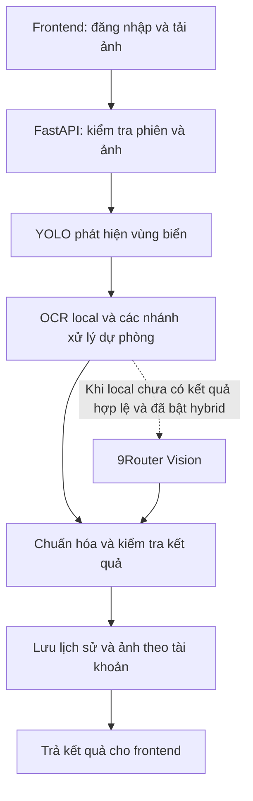

# Hệ thống nhận diện biển số xe Việt Nam

Ứng dụng web nhận diện biển số từ ảnh phương tiện: phát hiện vùng biển, đọc ký tự, hiển thị ảnh kết quả và lưu lịch sử theo tài khoản. Dự án sử dụng FastAPI cho backend và Next.js cho frontend.

**Quy ước đường dẫn:** mọi đường dẫn tệp trong tài liệu đều tính từ **thư mục gốc repository**, nơi chứa `main.py` và `requirements.txt`. Các lệnh bên dưới chạy tại thư mục này, không phụ thuộc ổ đĩa hoặc tên người dùng. `localhost` là địa chỉ máy đang chạy ứng dụng.

## 1. Chức năng hiện có

- Đăng ký, đăng nhập và đăng xuất bằng tài khoản email/mật khẩu.
- Tải ảnh lên để phát hiện và đọc một hoặc nhiều biển số; giới hạn tải lên 10 MB.
- Hiển thị chuỗi nhận diện, điểm tin cậy, ảnh cắt biển số và ảnh đánh dấu kết quả.
- Xem lịch sử, tìm kiếm biển số và xem chi tiết kết quả thuộc tài khoản đang đăng nhập.
- Nhận diện local bằng YOLO; hỗ trợ OCR dòng bằng EasyOCR và dịch vụ Vision qua 9Router khi được cấu hình.
- Kiểm thử tự động, benchmark có nhãn đối chứng và notebook phân tích thực nghiệm.

Điểm tin cậy và kiểm tra cấu trúc biển số không bảo đảm mọi ký tự đều chính xác. Ảnh mờ, nhiễu, biển quá nhỏ hoặc che khuất vẫn có thể đọc sai hoặc không có kết quả.

## 2. Công nghệ và luồng xử lý

| Thành phần | Công nghệ / vai trò |
|---|---|
| Frontend | Next.js 16, React 19, TypeScript, Tailwind CSS 4 |
| Backend | FastAPI, Uvicorn, Pydantic |
| Phát hiện biển số | Ultralytics YOLO, PyTorch; trọng số `models/best.pt` |
| OCR chính | YOLO nhận dạng ký tự; trọng số `models/LP_ocr.pt` |
| Xử lý ảnh | OpenCV: tăng tương phản, xử lý góc nghiêng, đề xuất và căn chỉnh vùng biển |
| OCR dự phòng local | EasyOCR nhận dạng dòng; trọng số `models/easyocr/english_g2.pth` |
| Vision tùy chọn | 9Router kết nối dịch vụ/model do người chạy cấu hình |
| Cơ sở dữ liệu mặc định | SQLite qua SQLAlchemy; tệp `data/alpr.db` |
| Tài khoản | Mật khẩu băm bằng scrypt, phiên đăng nhập qua cookie HttpOnly |



Luồng API ưu tiên xử lý local. Khi được cấu hình, dịch vụ Vision được gọi tối đa một lần cho mỗi yêu cầu nhận diện. Benchmark offline cơ bản và kiểm thử qua web có phạm vi khác nhau, được mô tả ở phần kiểm thử.

## 3. Cấu trúc thư mục

```text
license_plate_recognition/
├── frontend/                       # Giao diện Next.js
│   ├── src/app/                    # Nhận diện, đăng nhập, đăng ký, lịch sử
│   ├── src/components/             # Thành phần giao diện dùng chung
│   └── src/lib/                    # Hàm gọi API và xử lý phản hồi
├── src/
│   ├── api/                        # API nhận diện, tài khoản và schema
│   ├── core/                       # Detector, OCR, tiền/hậu xử lý ảnh
│   │   ├── detector.py
│   │   ├── ocr_engine.py
│   │   ├── preprocessor.py
│   │   ├── postprocessor.py
│   │   ├── plate_regions.py
│   │   ├── line_ocr.py
│   │   └── ninerouter_vision.py
│   ├── db/                         # Bảng dữ liệu, kết nối và migration
│   ├── evaluation/                 # Hàm tính metric từ dự đoán
│   ├── utils/                      # Log và vẽ kết quả
│   └── config.py                   # Đọc cấu hình môi trường
├── models/                         # Trọng số mô hình
├── data/
│   ├── raw/                        # Dữ liệu đầu vào
│   ├── test_cases/                 # Bộ ca khó tổng hợp và nhãn đối chứng
│   ├── test_real_web/              # Ảnh, manifest kiểm thử ảnh thật
│   ├── outputs/                    # Ảnh cắt biển và ảnh đánh dấu
│   ├── benchmarks/                 # Kết quả benchmark theo lượt chạy
│   ├── recognition_regression/     # Bằng chứng kiểm thử hồi quy
│   ├── notebook_runs/              # Bản notebook đã thực thi
│   └── alpr.db                     # SQLite, tạo khi chạy backend
├── notebooks/                      # Khám phá dữ liệu và thực nghiệm
├── tool/                           # Công cụ notebook, benchmark và thiết lập model
├── tests/                          # Kiểm thử tự động
├── docs/                           # Tài liệu dự án
├── .env.example                    # Tham khảo các biến môi trường
├── requirements.txt                # Thư viện Python
├── app.py                          # Entrypoint tương thích
├── main.py                         # Entrypoint backend chính
└── README.md
```

Trọng số, database và nhiều thư mục dữ liệu/kết quả không được Git theo dõi. Sau khi clone, cần cung cấp model và dữ liệu tương ứng; các thư mục đầu ra được tạo khi chạy công cụ liên quan.

## 4. Cài đặt

### 4.1. Chuẩn bị môi trường

- Python: môi trường phát triển đã kiểm thử trên Python 3.13 với PyTorch CPU.
- Node.js từ 20.9 trở lên và npm, theo yêu cầu của phiên bản Next.js trong dự án.
- Trọng số detector và OCR của dự án. GPU không bắt buộc cho cấu hình local.

Tải hoặc clone repository, sau đó mở terminal tại thư mục gốc.

Các ví dụ dùng **Windows PowerShell** và gọi trực tiếp Python trong môi trường ảo, không cần kích hoạt bằng `Activate.ps1`:

```powershell
python -m venv venv
.\venv\Scripts\python.exe -m pip install -r requirements.txt
npm --prefix frontend ci
```

Trên Linux/macOS, tạo môi trường bằng `python3 -m venv venv` và thay `.\venv\Scripts\python.exe` trong các lệnh bằng `./venv/bin/python`. Lệnh npm giữ nguyên.

### 4.2. Đặt trọng số mô hình

| Tệp | Mục đích | Yêu cầu |
|---|---|---|
| `models/best.pt` | Phát hiện biển số | Cần cho pipeline local đầy đủ |
| `models/LP_ocr.pt` | Nhận dạng ký tự | Cần cho YOLO OCR local |
| `models/easyocr/english_g2.pth` | Đọc dòng trên vùng biển khó | Tùy chọn, bổ sung nhánh dự phòng local |

Lấy `best.pt` và `LP_ocr.pt` từ bộ trọng số của dự án hoặc kết quả huấn luyện tương ứng, rồi đặt đúng vị trí trên. Chỉ clone mã nguồn chưa đủ để nhận diện.

Cài model OCR dòng dự phòng bằng lệnh riêng:

```powershell
.\venv\Scripts\python.exe tool/setup_ocr.py --download
```

Lệnh này tải model từ nguồn trong metadata của EasyOCR và kiểm tra checksum. Nhánh OCR dòng của backend chỉ nạp model đã có, không tải model trong yêu cầu nhận diện.

### 4.3. Cấu hình backend

Tạo tệp `.env` tại thư mục gốc với cấu hình local bên dưới. Nếu đã có `.env`, cập nhật các biến cần thiết thay vì ghi đè toàn bộ tệp.

```dotenv
APP_NAME="ALPR System"
APP_ENV=development
DEBUG=true
API_HOST=127.0.0.1
API_PORT=8000

OCR_ENGINE=yolo
YOLO_MODEL_PATH=models/best.pt
CONFIDENCE_THRESHOLD=0.5
INFERENCE_THREADS=2

DATABASE_URL=sqlite:///data/alpr.db
OUTPUT_DIR=data/outputs
STATIC_URL_PREFIX=/static

CORS_ORIGINS=http://localhost:3000,http://127.0.0.1:3000,http://localhost:8000,http://127.0.0.1:8000
AUTH_COOKIE_SECURE=false
AUTH_SESSION_DAYS=7
```

`OCR_ENGINE=yolo` dùng chế độ local, không cần 9Router. SQLite lưu dữ liệu trong dự án, không cần cài một máy chủ database riêng.

Nếu sử dụng Vision hỗ trợ, thay `OCR_ENGINE` và bổ sung cấu hình dịch vụ của bạn:

```dotenv
OCR_ENGINE=hybrid
NINEROUTER_BASE_URL=http://localhost:20128/v1
NINEROUTER_API_KEY=YOUR_API_KEY
NINEROUTER_MODEL=YOUR_MODEL_ID
NINEROUTER_TIMEOUT=6.0
```

`YOUR_API_KEY` và `YOUR_MODEL_ID` là giá trị mẫu cần thay. Chế độ hybrid có thể gửi ảnh hoặc vùng biển đến dịch vụ Vision được cấu hình. Độ trễ và kết quả phụ thuộc dịch vụ này; giữ thông tin truy cập trong `.env` riêng.

### 4.4. Cấu hình frontend

Frontend mặc định gọi `http://localhost:8000`. Để khai báo rõ hoặc đổi địa chỉ backend, tạo `frontend/.env.local`:

```dotenv
NEXT_PUBLIC_API_URL=http://localhost:8000
```

Khi đổi cổng/origin của frontend, cập nhật `CORS_ORIGINS` trong `.env` backend. Dùng cùng hostname khi truy cập frontend và backend, ví dụ đều là `localhost`, để cookie phiên được gửi nhất quán. Khởi động lại dịch vụ tương ứng sau khi đổi cấu hình.

## 5. Khởi chạy và sử dụng

Mở **hai terminal tại thư mục gốc dự án**.

Terminal 1 — backend:

```powershell
.\venv\Scripts\python.exe main.py
```

Terminal 2 — frontend:

```powershell
npm --prefix frontend run dev -- --port 3000
```

| Địa chỉ | Công dụng |
|---|---|
| [Ứng dụng web](http://localhost:3000/) | Giao diện nhận diện |
| [Đăng ký](http://localhost:3000/register) | Tạo tài khoản |
| [Đăng nhập](http://localhost:3000/login) | Truy cập tài khoản |
| [Backend](http://localhost:8000/) | Kiểm tra API có phản hồi |
| [Swagger](http://localhost:8000/docs) | Xem schema và thử API |
| [ReDoc](http://localhost:8000/redoc) | Tài liệu API |

1. Mở web bằng Brave hoặc trình duyệt khác.
2. Đăng ký bằng tên, email và mật khẩu từ 8–128 ký tự; hoặc đăng nhập tài khoản đã có.
3. Chọn ảnh phương tiện và thực hiện nhận diện.
4. Kiểm tra chuỗi đọc được với biển số trong ảnh; xem ảnh cắt và ảnh đánh dấu.
5. Mở lịch sử để tìm kiếm hoặc xem lại kết quả của mình.

API nhận diện, lịch sử và ảnh kết quả yêu cầu đăng nhập. Dữ liệu lịch sử cũ chưa có chủ sở hữu không tự gán cho tài khoản đăng ký mới. Hiện chưa có chức năng xác minh email hoặc khôi phục mật khẩu qua email.

Phản hồi `status: online` ở backend chỉ xác nhận dịch vụ đang chạy; cần thử một ảnh có nhãn để xác minh model hoạt động.

Để kiểm tra bản build frontend:

```powershell
npm --prefix frontend run build
npm --prefix frontend run start -- --port 3000
```

Dừng frontend đang chạy trên cùng cổng trước khi dùng `start`; backend vẫn chạy riêng. Khi triển khai qua HTTPS, cấu hình `AUTH_COOKIE_SECURE=true` và origin đúng với địa chỉ triển khai.

## 6. API chính

| Phương thức | Endpoint | Chức năng |
|---|---|---|
| `GET` | `/` | Trạng thái backend |
| `POST` | `/api/auth/register` | Tạo tài khoản và phiên đăng nhập |
| `POST` | `/api/auth/login` | Đăng nhập |
| `GET` | `/api/auth/me` | Thông tin tài khoản đang đăng nhập |
| `POST` | `/api/auth/logout` | Đăng xuất, thu hồi phiên |
| `POST` | `/api/license-plates/detect` | Gửi ảnh qua `multipart/form-data`, trường `file` |
| `GET` | `/api/license-plates/history?page=1&page_size=20` | Lịch sử cá nhân có phân trang |
| `GET` | `/api/license-plates/search?plate=29A` | Tìm kết quả theo chuỗi biển số |
| `GET` | `/api/license-plates/{detection_id}` | Chi tiết kết quả thuộc tài khoản |

Frontend gửi cookie với `credentials: include`. Xem kiểu request/response chi tiết tại Swagger khi backend đang chạy.

## 7. Kiểm thử và đánh giá

### 7.1. Kiểm thử tự động

```powershell
.\venv\Scripts\python.exe -m unittest discover -s tests -v
npm --prefix frontend run lint
npm --prefix frontend run build
```

Các bài kiểm thử Python bao gồm tài khoản, phân quyền dữ liệu, hậu xử lý biển số, ca khó, metric benchmark và kiểm tra tính nhất quán của bằng chứng notebook. Lệnh lint/build kiểm tra mã frontend; chúng không thay thế thao tác kiểm thử trên trình duyệt.

### 7.2. Benchmark offline có nhãn

Cần có ảnh và `data/test_cases/ground_truth.json` trước khi chạy:

```powershell
.\venv\Scripts\python.exe tool/benchmark.py --dataset-kind synthetic
```

Kết quả được lưu vào thư mục mới `data/benchmarks/<run-id>/`, gồm `metrics.json`, `predictions.json`, `per_image.csv` và các biểu đồ nếu bật xuất biểu đồ.

Bộ `data/test_cases` hiện tại là ảnh tổng hợp. Benchmark cơ bản đo detector, YOLO OCR và hậu xử lý; không bao gồm toàn bộ nhánh dự phòng API, cloud, HTTP, database hoặc giao diện. Chỉ số từ bộ này không đại diện độ chính xác trên ảnh giao thông thật.

Xem [định nghĩa chỉ số, định dạng nhãn và phạm vi benchmark](tool/BENCHMARK.md).

### 7.3. Kiểm thử hồi quy trên ảnh cố định

Tạo bộ ảnh của bạn, ví dụ trong `data/my_test_set/`, và manifest `data/my_test_set/cases.json`. Đường dẫn `path` bên trong manifest được tính từ thư mục làm việc; các lệnh dưới đây chạy từ gốc repository.

Ví dụ cấu trúc manifest — thay tên ảnh và nhãn bằng dữ liệu đã kiểm tra thủ công:

```json
{
  "cases": [
    {
      "id": "vehicle_01",
      "path": "data/my_test_set/vehicle_01.jpg",
      "kind": "real",
      "expected": ["29A-123.45"]
    },
    {
      "id": "negative_01",
      "path": "data/my_test_set/negative_01.jpg",
      "kind": "real",
      "expected": []
    }
  ]
}
```

`expected` liệt kê tất cả biển số có thể xác định trong ảnh; dùng mảng rỗng cho ảnh không có biển. Ảnh tổng hợp dùng `kind: "synthetic"`, không trộn với nhóm ảnh thật khi tổng hợp kết quả.

```powershell
.\venv\Scripts\python.exe tool/check_regression.py --label local_before --mode local --cases data/my_test_set/cases.json
```

Công cụ gọi trực tiếp handler API, sử dụng database và thư mục ảnh đầu ra riêng cho từng lượt. Bằng chứng nằm trong `data/recognition_regression/<run-id>/`, gồm manifest, hash ảnh, nhãn đối chứng và phản hồi nhận diện. Đây chưa phải kiểm thử qua trình duyệt.

Sau khi sửa nhận diện, chạy lại với cùng ảnh, cùng nhãn và đổi nhãn lượt chạy thành `local_after`. Dùng `--mode hybrid` nếu cần đánh giá riêng chế độ có dịch vụ Vision. Không gộp kết quả local và hybrid hoặc sửa nhãn để khớp dự đoán.

### 7.4. Kiểm thử trực tiếp trên web

Chạy cả backend/frontend, đăng nhập bằng tài khoản kiểm thử và tải lên đúng các ảnh trong manifest. Đối chiếu từng biển hiển thị với `expected`, kiểm tra lịch sử và lưu bằng chứng trước/sau.

Kiểm thử qua trình duyệt cần Playwright cùng trình duyệt được cài riêng và nên dùng môi trường kiểm thử riêng.

## 8. Notebooks

Notebook phục vụ thực nghiệm và phân tích; không cần chạy notebook để khởi động web.

| Notebook | Nội dung |
|---|---|
| [01 — Khám phá dữ liệu](notebooks/01_data_exploration.ipynb) | Kiểm tra ảnh, bbox, kích thước, độ sáng và nguồn dữ liệu |
| [02 — Thực nghiệm tiền xử lý](notebooks/02_preprocessing_experiments.ipynb) | So sánh OCR trên cùng crop trước/sau tăng cường ảnh |
| [03 — Đánh giá kết quả](notebooks/03_evaluation_metrics.ipynb) | Tính lại metric từ dự đoán lưu và so sánh các lượt hồi quy |

```powershell
.\venv\Scripts\python.exe tool/run_notebooks.py
.\venv\Scripts\python.exe tool/run_notebooks.py --execute
```

Lệnh đầu kiểm tra định dạng. Lệnh `--execute` chạy các ô và lưu bản đã thực thi trong `data/notebook_runs/<run-id>/`, không ghi đè notebook nguồn. Notebook cần dữ liệu/model và các lượt bằng chứng tương ứng; không tự có đủ dữ liệu sau khi clone repository.

Xem [hướng dẫn notebook và điều kiện dữ liệu](notebooks/README.md). Khi chuyển máy, cần cập nhật đường dẫn ở ô cấu hình hoặc manifest cho phù hợp, giữ nguyên ảnh và nhãn đối chứng.

## 9. Xử lý lỗi thường gặp

| Hiện tượng | Kiểm tra |
|---|---|
| Không mở được web | Terminal frontend có chạy không, cổng 3000 có bị chiếm không |
| Web không kết nối backend | Mở địa chỉ backend, kiểm tra `NEXT_PUBLIC_API_URL`, cổng 8000 và log backend |
| Đăng nhập xong vẫn bị yêu cầu đăng nhập | Kiểm tra cookie, dùng cùng hostname, đối chiếu `CORS_ORIGINS`; khi chạy HTTP local dùng `AUTH_COOKIE_SECURE=false` |
| Backend chạy nhưng không nhận diện | Kiểm tra cả `models/best.pt` và `models/LP_ocr.pt`, log nạp model và ảnh đầu vào |
| Nhánh OCR dòng không hoạt động | Kiểm tra `models/easyocr/english_g2.pth` bằng `tool/setup_ocr.py` |
| Hybrid chậm hoặc báo hết thời gian | Kiểm tra dịch vụ 9Router, model ID và thông tin truy cập; đối chiếu riêng với chế độ `yolo` |
| Ảnh bị từ chối | Dùng ảnh giải mã được và kích thước không vượt giới hạn tải lên |
| Đổi mã nhưng kết quả chưa thay đổi | Kiểm tra đúng tiến trình backend/frontend đang phục vụ và khởi động lại nếu không dùng chế độ reload |
| Notebook thiếu tệp dữ liệu/kết quả | Đọc ô cấu hình và cung cấp đúng ảnh, manifest, model hoặc lượt benchmark được tham chiếu |

Khi phát hiện nhận diện sai, giữ ảnh gốc và nhãn đã xác minh, lưu phản hồi thực tế rồi bổ sung vào bộ hồi quy để kiểm tra lại sau khi sửa.
