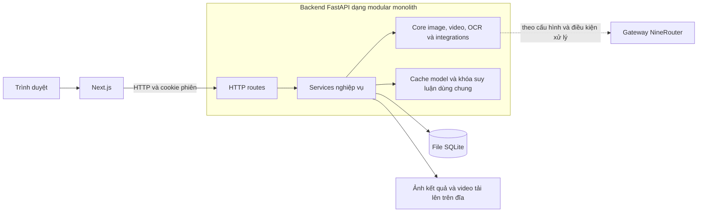

# Nhận diện biển số xe Việt Nam

Ứng dụng web nhận diện biển số từ ảnh và video tải lên, theo vết phương tiện và lưu lịch sử nhận diện ảnh theo tài khoản. Phạm vi triển khai hiện tại là một backend FastAPI và một frontend Next.js trên một máy chủ.

## Kiến trúc triển khai

Backend là **modular monolith**: API, model AI, kết nối database và executor video nằm trong cùng ứng dụng FastAPI. Frontend Next.js chạy ở tiến trình riêng và gọi HTTP API. Database hiện được kiểm tra là SQLite; khả năng vận hành PostgreSQL và nhiều worker phân tán chưa được kiểm chứng.

Frontend khai báo Next.js 16.4.5 và React/React DOM 19.3.0 trong `frontend/package.json`. Backend khai báo dependency trong `requirements.txt`; nhiều package dùng giới hạn `>=`, nên phiên bản cài ở máy khác có thể khác. Snapshot phiên bản đã kiểm tra nằm trong [AUDIT.md](AUDIT.md).



`_inference_lock` tuần tự hóa suy luận local; đọc/giải mã ảnh, gọi cloud và ghi file/DB của service ảnh nằm ngoài khóa. Video sử dụng `ThreadPoolExecutor(max_workers=1)` trong `services/video_jobs.py`, giới hạn tối đa hai job queued/running và lưu trạng thái/kết quả vào SQLite. File lock phân biệt worker đang chạy với job bị gián đoạn; job bị gián đoạn được đánh dấu failed khi đọc hoặc nhận job mới, không tự chạy lại. Các giới hạn này không phải bằng chứng tải nhiều camera hoặc xử lý thời gian thực.

## Cấu trúc thư mục

```text
main.py                     FastAPI, lifespan, CORS, đăng ký router và adapter ảnh riêng tư
src/
  config.py                 Settings từ môi trường và .env
  api/
    auth.py                 HTTP adapter tài khoản và dependency xác thực
    routes.py               HTTP adapter nhận diện ảnh/lịch sử
    video_routes.py         HTTP adapter tác vụ video/media
  services/
    authentication.py       Validation tài khoản, scrypt, phiên, throttle và nghiệp vụ auth
    schemas.py              DTO kết quả ảnh/lịch sử, giữ nguyên schema công khai
    model_runtime.py        Cache model ảnh/video và khóa suy luận dùng chung
    image_recognition.py    Điều phối nhận diện ảnh và lưu kết quả
    history.py              Truy vấn lịch sử theo chủ sở hữu
    video_jobs.py           Upload, worker, job SQLite, tiến trình và media
    result_media.py         Kiểm tra chủ sở hữu và trả ảnh kết quả riêng tư
  core/
    image/
      detector.py           YOLO phát hiện/cắt biển
      preprocessor.py       Tiền xử lý và nắn ảnh
      plate_regions.py      Ứng viên vùng biển bằng hình học
      character_regions.py  Ứng viên vùng biển từ các box ký tự
    ocr/
      engine.py             YOLO OCR ảnh và các nhánh bổ trợ
      line_ocr.py           EasyOCR dòng tùy chọn
      postprocessor.py      Chuẩn hóa và kiểm tra định dạng biển
    video/
      models.py             Adapter detector/OCR video
      tracker.py            ByteTrack phương tiện, ghép biển và tổng hợp lượt đọc
      unassigned_plates.py  Theo dõi các lượt đọc biển chưa ghép được với xe
      plate_reader.py       Lõi đọc biển được tích hợp từ nguồn bên ngoài
      video_ocr.yaml        Cấu hình OCR video đi kèm
    integrations/
      ninerouter_vision.py  HTTP client cho dịch vụ Vision qua gateway
  db/
    session.py              SQLAlchemy engine/session
    models.py               ORM tài khoản, phiên, thử xác thực và lịch sử ảnh
    migrations.py           Chỉ tạo schema, bổ sung owner_id và index
    seed.py                 Seed chủ động, dùng policy từ service xác thực
  evaluation/metrics.py     Metric detection, nội dung biển và thời gian
  utils/                    Log và vẽ annotation
frontend/                   Giao diện Next.js
  src/app/                  Các trang ảnh, video, lịch sử, đăng nhập/đăng ký
  src/components/           Thành phần giao diện dùng lại
  src/lib/                  Client API và dữ liệu tra cứu biển số
  src/types/                Kiểu dữ liệu API và video
  public/                   Tài nguyên tĩnh
scripts/                    Cài model, benchmark, hồi quy, seed và runner notebook
requirements-dev.txt        Dependency test/lint, bao gồm requirements.txt
benchmark/                  Playwright và hướng dẫn đánh giá
  ui/                       Kịch bản kiểm thử luồng giao diện
notebooks/                  Notebook phân tích và module hỗ trợ
models/                     Trọng số cục bộ, hướng dẫn và checksums.txt
data/                       Chỉ dữ liệu runtime, toàn bộ bị ignore
tests/
  fixtures/test_cases/      Ảnh tổng hợp có nhãn được giữ trong Git
  test_*.py                 Test hành vi và hồi quy
docs/                       Hướng dẫn chuyên đề, báo cáo Word/PDF và biểu đồ
  results/                  Báo cáo kiểm chứng và dữ liệu đối chiếu
pytest.ini                  Giới hạn test discovery vào tests/
Dockerfile                  COPY toàn bộ src/, gồm core và services
docker-compose.yml          Backend/frontend và volume model/dữ liệu
```

`src/api/` xử lý HTTP, `src/services/` điều phối nghiệp vụ và `src/core/` tập trung thuật toán nhận diện. `scripts/` chứa lệnh kỹ thuật đang dùng, còn `script/` là bản cục bộ cũ bị ignore. Benchmark sinh đầu ra mới dưới `data/`, kho khôi phục và snapshot cũ nằm trong `.local_archive/`. Nguồn mã và trọng số video được ghi trong [tài liệu video](docs/video_onnx.md#nguon-ma-va-model).

## Hai luồng nhận diện

| Luồng | Thành phần chính | Nhánh bổ trợ |
|---|---|---|
| Ảnh qua `/api/license-plates/detect` | Detector `models/best.pt`, OCR ký tự `models/LP_ocr.pt`, chuẩn hóa biển Việt Nam | Vùng ứng viên hình học, OCR dòng EasyOCR; NineRouter nếu cấu hình cho phép và local chưa có biển hợp lệ |
| Video qua API, mode `fast` | `models/yolov8n.pt` + ByteTrack theo vết phương tiện; `DetectLisence_YOLO11.pt` phát hiện biển; CCT ONNX đọc ký tự | Retry crop/đọc theo code tracker; không gọi OCR từ xa qua API ở mode này |
| Video qua API, mode `detailed`/`combined` | Dùng detector/OCR ảnh qua factory; `combined` chạy hai lượt fast/detailed rồi gộp | Có thể dùng NineRouter theo cấu hình và điều kiện tracker |

Luồng video mặc định có `VIDEO_ENGINE=onnx`; `legacy` chọn bộ detector/OCR ảnh cho mode fast. Tên mode và engine là hai lựa chọn khác nhau. Chi tiết nạp model/cấu hình, lấy mẫu và giới hạn đầu vào nằm trong [tài liệu video](docs/video_onnx.md). Web dùng phần OCR của `PlateReader` qua `VideoPlateOCR`. Luồng theo vết phương tiện và tổng hợp kết quả của web nằm tại [src/core/video/tracker.py](src/core/video/tracker.py).

Route ảnh chỉ nhận request và gọi `services/image_recognition.py`; model được lấy qua `services/model_runtime.py`. Service giữ nguyên thứ tự xử lý và lưu kết quả trước khi trả DTO cho route. `PlateOCREngine.recognize_plate()` còn có các nhánh truyền thống/remote; thứ tự xử lý của method đó không thay thế thứ tự local trước của route ảnh. Điều kiện và dữ liệu gửi ra ngoài được mô tả tại [docs/cloud_ocr.md](docs/cloud_ocr.md).

## Cài đặt

Mọi lệnh dưới đây chạy từ thư mục gốc repository bằng PowerShell. Môi trường đã kiểm tra dùng Python 3.13; Dockerfile backend dùng Python 3.11. Next.js yêu cầu Node.js từ 20.9.

```powershell
python -m venv venv
.\venv\Scripts\python.exe -m pip install -r requirements.txt
npm --prefix frontend ci
if (-not (Test-Path .env)) { Copy-Item .env.example .env }
```

Để dùng FastPlateOCR cho ảnh tải lên, cài bộ model video bên dưới, đặt `OCR_ENGINE=fastplate` trong `.env` và khởi động lại backend. Chế độ này dùng detector ảnh `best.pt`, đọc vùng biển bằng CCT-VN và dùng `LP_ocr.pt` để đọc lại khi ký tự thiếu chắc chắn hoặc cần xác định dòng. Cả hai bước chạy cục bộ. Để so sánh, chọn `yolo` cho YOLO OCR hoặc `onnx` (bí danh `cct`) cho CCT thuần qua `VIDEO_OCR_MODEL_PATH` và `VIDEO_OCR_CONFIG_PATH`. Giá trị mặc định trong mã và `.env.example` là `hybrid`. [Cấu hình OCR từ xa](docs/cloud_ocr.md)

Chuẩn bị `models/best.pt`, `models/LP_ocr.pt` và `models/yolov8n.pt` theo [hướng dẫn trọng số](models/weights_readme.txt). Backend cần detector ảnh và OCR tương ứng với engine đã chọn khi khởi động; model phương tiện trong `models/` được dùng khi xử lý video. Trọng số không được đưa lên Git.

Cài bộ model bổ trợ cho video mặc định:

```powershell
.\venv\Scripts\python.exe scripts/setup_video_models.py
```

EasyOCR dòng dự phòng là tùy chọn: `.\venv\Scripts\python.exe scripts/setup_ocr.py --download`.

## Khởi động

Mở hai terminal tại thư mục gốc:

```powershell
# Terminal 1: backend
.\venv\Scripts\python.exe main.py
```

```powershell
# Terminal 2: frontend
npm --prefix frontend run dev
```

Mở [giao diện web](http://localhost:3000) và đăng ký tại `/register`. Database được khởi tạo khi backend chạy; code không seed tài khoản mặc định. Các tài khoản có sẵn trên máy phát triển không đi kèm bản clone. Nếu cần tạo bằng CLI, dùng [lệnh seed chủ động](docs/security.md); không có mật khẩu mặc định.

| Trang | Chức năng |
|---|---|
| `/` | Tải ảnh, nhận diện và xem ảnh đánh dấu |
| `/video` | Tải video, xem tiến trình và kết quả theo vết |
| `/history` | Tìm kiếm, phân trang lịch sử nhận diện ảnh của tài khoản |
| `/login`, `/register` | Đăng nhập, đăng ký |

Backend có [Swagger](http://localhost:8000/docs) và [ReDoc](http://localhost:8000/redoc). Khi đổi địa chỉ API, xem [cấu hình frontend](frontend/README.md).

## API hiện hành

Danh sách dưới đây đối chiếu từ `main.app.openapi()`; không dùng tiền tố phiên bản API.

| Method | Endpoint | Quyền truy cập |
|---|---|---|
| GET | `/` | Công khai; trạng thái backend |
| POST | `/api/auth/register` | Công khai; có giới hạn thử |
| POST | `/api/auth/login` | Công khai; có giới hạn thử |
| GET | `/api/auth/me` | Có phiên hợp lệ |
| POST | `/api/auth/logout` | Xóa phiên cookie nếu có |
| POST | `/api/license-plates/detect` | Có phiên hợp lệ |
| GET | `/api/license-plates/history` | Chỉ lịch sử thuộc tài khoản |
| GET | `/api/license-plates/search` | Chỉ lịch sử thuộc tài khoản |
| GET | `/api/license-plates/{detection_id}` | Chỉ bản ghi thuộc tài khoản |
| POST | `/api/video-tracking/jobs` | Có phiên hợp lệ |
| GET | `/api/video-tracking/jobs/{job_id}` | Chủ sở hữu job |
| GET | `/api/video-tracking/jobs/{job_id}/media` | Chủ sở hữu job |

Ngoài schema OpenAPI, `GET /static/{category}/{filename}` kiểm tra bản ghi ảnh thuộc tài khoản trước khi trả file. Tài liệu API được phục vụ tại `/docs`, `/redoc`, schema tại `/openapi.json`. Lịch sử và tìm kiếm hỗ trợ `page`, `page_size`; tìm kiếm nhận query `plate`. Chưa có API quản trị người dùng, xuất/xóa lịch sử, reset mật khẩu hoặc RTSP/camera trực tiếp.

## Xác thực và database

`src/services/authentication.py` băm mật khẩu bằng **scrypt** với salt ngẫu nhiên; `src/api/auth.py` giữ các HTTP adapter và dependency xác thực. Đăng nhập tạo token opaque ngẫu nhiên; trình duyệt giữ cookie `platesight_session`, database lưu SHA256 của token và thời điểm hết hạn. Cookie có HttpOnly, SameSite=Lax; Secure bật theo cấu hình hoặc môi trường production. Frontend gửi cookie qua fetch với `credentials: "include"` và lấy trạng thái từ `/api/auth/me`.

Quyền dữ liệu được kiểm tra theo người sở hữu. ORM không có cột role hay quyền Admin/Guest. Người chưa có phiên chỉ có thể dùng các chức năng công khai. Code không seed tài khoản mặc định; người dùng mới đăng ký qua ứng dụng. Lệnh `scripts/seed_user.py` là tùy chọn chủ động, đọc biến môi trường và không ghi đè người dùng đã có; xem [hướng dẫn tài khoản/secret](docs/security.md).

| Model ORM | Bảng | Các cột |
|---|---|---|
| `User` | `users` | `id`, `name`, `email`, `password_hash`, `created_at` |
| `UserSession` | `user_sessions` | `token_hash`, `user_id`, `expires_at` |
| `AuthAttempt` | `auth_attempts` | Bảng cũ được giữ tương thích; rate limiter dùng sliding window trong RAM có khóa luồng |
| `PlateHistory` | `plate_history` | `id`, `owner_id`, `plate_number`, `plate_number_clean` (index), `confidence`, `plate_type`, `engine_used`, `cropped_plate_url`, `annotated_image_url`, `created_at` |
| `VideoJob` | `video_jobs` | `id`, `owner_id`, `filename`, `mode`, `status`, `progress`, `error`, `result_json`, `created_at`, `updated_at` |

SQLite mặc định ở `data/alpr.db`; `DATABASE_URL` có thể thay đổi. `migrations.py` tạo bảng thiếu, backfill biển số chuẩn hóa và index, không seed dữ liệu. Job video được lưu trong SQLite; video tải lên và file lock lưu tại `data/video_jobs/`. Media hỗ trợ HTTP Range (206, 416) qua Starlette FileResponse.

## Giới hạn bằng chứng

Tập ảnh kèm repository hiện có 40 ảnh tổng hợp (`tests/fixtures/test_cases/`); không đại diện chất lượng trên giao thông thực tế. Các file biểu đồ có sẵn và số lượt đọc đúng định dạng không tự chứng minh độ chính xác. Chưa có số đo hiện tại về tải đồng thời lớn, MOTA/IDF1, ablation hoặc vận hành production.

## Tài liệu theo công việc

| Cần làm | Tài liệu |
|---|---|
| Xem kết quả nâng cấp backend | [Backend hardening](docs/results/backend_hardening.md) |
| Xem test, benchmark và Docker mới nhất | [Giai đoạn 5](docs/results/evaluation.md) |
| Tái cấu trúc và kiểm tra trước–sau | [Giai đoạn 4](docs/results/service_refactor.md) |
| Tra script kỹ thuật | [scripts/README.md](scripts/README.md) |
| Cài model | [models/weights_readme.txt](models/weights_readme.txt) |
| Quản lý tài khoản seed và secret | [docs/security.md](docs/security.md) |
| Hiểu dữ liệu gửi qua NineRouter | [docs/cloud_ocr.md](docs/cloud_ocr.md) |
| Cấu hình và đánh giá video | [docs/video_onnx.md](docs/video_onnx.md) |
| Chạy test và kiểm tra frontend | [tests/TESTING.md](tests/TESTING.md) |
| Đo thao tác ứng dụng hoặc độ chính xác ảnh | [benchmark/README.md](benchmark/README.md), [benchmark/ACCURACY.md](benchmark/ACCURACY.md) |
| Phân tích bằng notebook | [notebooks/README.md](notebooks/README.md) |
| Phân biệt fixture và dữ liệu runtime | [docs/data.md](docs/data.md) |
| Tra nguồn mã/model và trạng thái báo cáo | [Nguồn mã/model](docs/video_onnx.md#nguon-ma-va-model), [docs/README.md](docs/README.md) |

Kết quả đo ngày 19/11/2026 và giới hạn dữ liệu nằm trong [báo cáo giai đoạn 5](docs/results/evaluation.md). Bộ ảnh kèm repository là ảnh tổng hợp; số test phần mềm đạt không thể thay cho đánh giá trên giao thông thực tế. Kết quả local và trạng thái cloud được báo cáo riêng.
