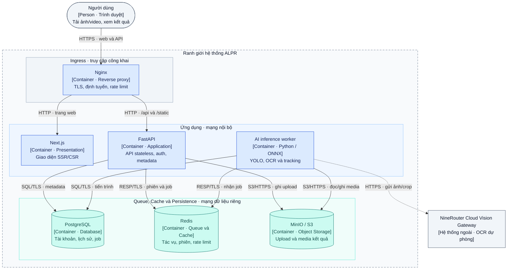

# Nhận diện biển số xe Việt Nam

Ứng dụng web nhận diện biển số từ ảnh và video tải lên, theo vết phương tiện và lưu lịch sử nhận diện ảnh theo tài khoản. Cấu hình chạy mặc định gồm FastAPI, Next.js, SQLite và lưu trữ cục bộ. Mã cũng hỗ trợ PostgreSQL, S3/MinIO, Redis và worker nhận diện riêng khi cấu hình các dịch vụ đó.

<a id="kien-truc-trien-khai"></a>

## Kiến trúc triển khai

### Hiện hành — một máy chủ

Next.js chạy ở tiến trình riêng. Trình duyệt gọi trực tiếp FastAPI theo `NEXT_PUBLIC_API_URL` và gửi cookie phiên. Khi `REDIS_URL` và `INFERENCE_WORKER_URL` để trống, FastAPI xử lý ảnh và dùng hàng đợi video trong bộ nhớ với một luồng xử lý. File Compose hiện chỉ định backend và frontend, mở cổng 8000 và 3000, dùng SQLite và lưu media cục bộ. [Cấu hình dữ liệu và lưu trữ](docs/data.md)

Khi đặt `REDIS_URL`, video đi qua Redis Stream và cần chạy `scripts/run_worker.py` để tiêu thụ job. Khi đặt thêm `INFERENCE_WORKER_URL`, API chuyển request nhận diện ảnh đồng bộ sang worker đó; worker phải truy cập cùng database, Redis và kho media. `SESSION_BACKEND=redis` là tùy chọn cho phiên dùng chung; mặc định phiên nằm trong database. Giới hạn đăng nhập dùng Redis khi có `REDIS_URL`, còn mặc định dùng bộ nhớ tiến trình. `_inference_lock` tuần tự hóa các đoạn suy luận local trong mỗi tiến trình. Hệ thống nhận tối đa hai video job queued/running. [Tài liệu video](docs/video_onnx.md)

### Mục tiêu — triển khai phân tán

Sơ đồ C4 cấp 2 mô tả đích triển khai có Nginx và mạng dịch vụ riêng. Các adapter PostgreSQL, Redis, S3 và worker đã có trong mã; Compose hiện chưa khai báo những dịch vụ đó. Hướng dẫn khởi động bên dưới áp dụng cho cấu hình mặc định. [C4 Container Diagram](https://c4model.com/diagrams/container)



**Luồng dữ liệu dự kiến**

1. Trình duyệt đi qua một origin HTTPS. Nginx chuyển trang và tài nguyên giao diện sang Next.js, chuyển `/api/*` và `/static/*` sang FastAPI. API xác thực bằng cookie phiên và kiểm tra quyền truy cập trước khi xử lý upload hoặc trả media.
2. API ghi ảnh/video vào kho đối tượng riêng, lưu metadata vào PostgreSQL và gửi mã job cùng tham chiếu tệp qua Redis. Với video, API trả `job_id` để giao diện tiếp tục truy vấn tiến trình. Với ảnh, API nhận kết quả worker trong thời hạn của request để duy trì phản hồi đồng bộ của endpoint hiện tại.
3. Worker đọc tệp từ kho đối tượng, chạy pipeline, lưu media kết quả và cập nhật trạng thái, metadata. Worker có thể gọi NineRouter khi OCR local chưa đủ và cấu hình cho phép. API phục vụ ảnh riêng tư và video theo URL hiện có, kiểm tra chủ sở hữu trước khi trả nội dung và giữ hỗ trợ HTTP Range của video.

**Ranh giới bảo mật dự kiến**

- Nginx là dịch vụ nhận kết nối từ Internet. Nginx áp dụng giới hạn lưu lượng ở biên, còn API áp dụng hạn mức đăng nhập dùng Redis để chia sẻ trạng thái giữa các bản sao.
- Next.js, FastAPI và worker dùng mạng nội bộ. PostgreSQL, Redis và kho đối tượng được giới hạn cho dịch vụ cần truy cập, dùng xác thực dịch vụ và quyền tối thiểu. Bucket media là riêng tư.
- Kết nối tới NineRouter đi qua ranh giới của hệ thống. Worker giữ khóa gateway và chỉ gửi dữ liệu phục vụ OCR khi nhánh dự phòng được bật. Xem [thiết kế kiểm soát truy cập](docs/security.md) và [phạm vi dữ liệu OCR từ xa](docs/cloud_ocr.md).

## Cấu trúc thư mục

```text
main.py                     create_app(), lắp ráp FastAPI và điểm chạy main:app
src/
  config.py                 Settings từ môi trường và .env
  api/
    auth.py                 HTTP adapter tài khoản và dependency xác thực
    lifespan.py             Chuẩn bị thư mục đầu ra, DB và model ảnh khi khởi động
    middlewares.py          CORS, kiểm tra origin và trace request
    error_handlers.py       Ánh xạ lỗi nghiệp vụ và validation sang HTTP
    health_routes.py        Trạng thái công khai và kiểm tra DB/model/lưu trữ
    media_routes.py         Route ảnh riêng tư theo chủ sở hữu
    routes.py               HTTP adapter nhận diện ảnh/lịch sử
    video_routes.py         HTTP adapter tác vụ video/media
  services/
    authentication.py       Validation tài khoản, scrypt, phiên, throttle và nghiệp vụ auth
    schemas.py              DTO kết quả ảnh/lịch sử, giữ nguyên schema công khai
    model_runtime.py        Cache model ảnh/video và khóa suy luận dùng chung
    queue/                  Hàng đợi video trong bộ nhớ hoặc Redis Stream
    redis_runtime.py        Redis client dùng chung
    cloud_vision.py         Chọn adapter OCR từ xa theo engine
    image_recognition.py    Điều phối nhận diện ảnh và lưu kết quả
    history.py              Truy vấn lịch sử theo chủ sở hữu
    video_jobs.py           Upload, executor video, trạng thái job và quyền truy cập media
    result_media.py         Kiểm tra chủ sở hữu và trả ảnh kết quả riêng tư
    storage/                Giao diện lưu ảnh/video, adapter local và S3
  core/
    models/                 Registry trọng số có phiên bản và factory ModelRuntime
    image/
      detector.py           YOLO phát hiện/cắt biển
      preprocessor.py       Tiền xử lý và nắn ảnh
      plate_regions.py      Ứng viên vùng biển bằng hình học
      character_regions.py  Ứng viên vùng biển từ các box ký tự
    ocr/
      engine.py             YOLO OCR ảnh và các nhánh bổ trợ
      line_ocr.py           EasyOCR dòng tùy chọn
      postprocessor.py      Chuẩn hóa và kiểm tra định dạng biển
    video/
      models.py             Adapter detector/OCR video
      tracker.py            ByteTrack phương tiện, ghép biển và tổng hợp lượt đọc
      unassigned_plates.py  Theo dõi các lượt đọc biển chưa ghép được với xe
      plate_reader.py       Lõi đọc biển được tích hợp từ nguồn bên ngoài
      video_ocr.yaml        Cấu hình OCR video đi kèm
    integrations/
      base.py               Giao diện ICloudVisionClient
  infrastructure/
    inference_worker.py     Chuyển request ảnh từ API sang worker riêng
    ninerouter_vision.py    Adapter HTTP gọi dịch vụ Vision qua gateway
  db/
    session.py              SQLAlchemy engine/session cho SQLite và PostgreSQL
    job_locks.py            Khóa sở hữu job video trên PostgreSQL
    models.py               ORM tài khoản, phiên, thử xác thực và lịch sử ảnh
    migrations.py           Chỉ tạo schema, bổ sung owner_id và index
    seed.py                 Seed chủ động, dùng policy từ service xác thực
  evaluation/metrics.py     Metric detection, nội dung biển và thời gian
  utils/                    Log và vẽ annotation
frontend/                   Giao diện Next.js
  src/app/                  Các trang ảnh, video, lịch sử, đăng nhập/đăng ký
  src/components/           Thành phần giao diện dùng lại
  src/lib/                  Client API và dữ liệu tra cứu biển số
  src/types/                Kiểu dữ liệu API và video
  public/                   Tài nguyên tĩnh
scripts/                    Cài model, benchmark, hồi quy, seed và runner notebook
  run_worker.py             Chạy worker ảnh/video khi dùng Redis
requirements-dev.txt        Dependency test/lint, bao gồm requirements.txt
benchmark/                  Playwright và hướng dẫn đánh giá
  ui/                       Kịch bản kiểm thử luồng giao diện
notebooks/                  Notebook phân tích và module hỗ trợ
models/                     Trọng số cục bộ, hướng dẫn và checksums.txt
data/                       Chỉ dữ liệu runtime, toàn bộ bị ignore
tests/
  fixtures/test_cases/      Ảnh tổng hợp có nhãn được giữ trong Git
  test_*.py                 Test hành vi và hồi quy
docs/                       Hướng dẫn chuyên đề, báo cáo Word/PDF và biểu đồ
  results/                  Báo cáo kiểm chứng và dữ liệu đối chiếu
pytest.ini                  Giới hạn test discovery vào tests/
Dockerfile                  COPY toàn bộ src/, gồm core và services
docker-compose.yml          Backend/frontend và volume model/dữ liệu
```

`src/api/` xử lý HTTP, `src/services/` điều phối nghiệp vụ, `src/core/` tập trung thuật toán nhận diện và `src/infrastructure/` chứa adapter kết nối bên ngoài. `scripts/` chứa lệnh kỹ thuật đang dùng, còn `script/` là bản cục bộ cũ bị ignore. Benchmark sinh đầu ra mới dưới `data/`, kho khôi phục và snapshot cũ nằm trong `.local_archive/`. Nguồn mã và trọng số video được ghi trong [tài liệu video](docs/video_onnx.md#nguon-ma-va-model).

## Hai luồng nhận diện

| Luồng | Thành phần chính | Nhánh bổ trợ |
|---|---|---|
| Ảnh qua `/api/license-plates/detect` | Detector `models/best.pt`, OCR ký tự `models/LP_ocr.pt`, chuẩn hóa biển Việt Nam | Vùng ứng viên hình học, OCR dòng EasyOCR; NineRouter nếu cấu hình cho phép và local chưa có biển hợp lệ |
| Video qua API, mode `fast` | `models/yolov8n.pt` + ByteTrack theo vết phương tiện; `DetectLisence_YOLO11.pt` phát hiện biển; CCT ONNX đọc ký tự | Retry crop/đọc theo code tracker; không gọi OCR từ xa qua API ở mode này |
| Video qua API, mode `detailed`/`combined` | Dùng detector/OCR ảnh qua factory; `combined` chạy hai lượt fast/detailed rồi gộp | Có thể dùng NineRouter theo cấu hình và điều kiện tracker |

Luồng video mặc định có `VIDEO_ENGINE=onnx`; `legacy` chọn bộ detector/OCR ảnh cho mode fast. Tên mode và engine là hai lựa chọn khác nhau. Chi tiết nạp model/cấu hình, lấy mẫu và giới hạn đầu vào nằm trong [tài liệu video](docs/video_onnx.md). Web dùng phần OCR của `PlateReader` qua `VideoPlateOCR`. Luồng theo vết phương tiện và tổng hợp kết quả của web nằm tại [src/core/video/tracker.py](src/core/video/tracker.py).

Route ảnh gọi `src/services/image_recognition.py` ở cấu hình mặc định, hoặc chuyển request sang worker khi có `INFERENCE_WORKER_URL`. Service lấy model từ `model_runtime.py`, xử lý local trước khi gọi OCR từ xa, rồi lưu kết quả và trả DTO. Job video dùng hàng đợi trong bộ nhớ hoặc Redis theo `REDIS_URL`. Service ảnh và job video lấy cloud client qua `ICloudVisionClient` khi engine cho phép. [Điều kiện gọi và dữ liệu gửi tới NineRouter](docs/cloud_ocr.md)

## Cài đặt

Mọi lệnh dưới đây chạy từ thư mục gốc repository bằng PowerShell. Môi trường đã kiểm tra dùng Python 3.13; Dockerfile backend dùng Python 3.11. Next.js yêu cầu Node.js từ 20.9.

```powershell
python -m venv venv
.\venv\Scripts\python.exe -m pip install -r requirements.txt
npm --prefix frontend ci
if (-not (Test-Path .env)) { Copy-Item .env.example .env }
```

Để dùng FastPlateOCR cho ảnh tải lên, cài bộ model video bên dưới, đặt `OCR_ENGINE=fastplate` trong `.env` và khởi động lại backend. Chế độ này dùng detector ảnh `best.pt`, đọc vùng biển bằng CCT-VN và dùng `LP_ocr.pt` để đọc lại khi ký tự thiếu chắc chắn hoặc cần xác định dòng. Cả hai bước chạy cục bộ. Để so sánh, chọn `yolo` cho YOLO OCR hoặc `onnx` (bí danh `cct`) cho CCT thuần qua `VIDEO_OCR_MODEL_PATH` và `VIDEO_OCR_CONFIG_PATH`. Giá trị mặc định trong mã và `.env.example` là `hybrid`. [Cấu hình OCR từ xa](docs/cloud_ocr.md)

Cài và xác minh bộ `baseline-v1` theo [hướng dẫn trọng số](models/weights_readme.txt). Backend nạp detector và OCR ảnh khi khởi động. Model video được nạp theo nhu cầu. Nếu đã có `best.pt` và `LP_ocr.pt` của bộ mặc định, trình cài sẽ xác minh hai tệp đó và tự tải các trọng số video còn thiếu.

```powershell
.\venv\Scripts\python.exe scripts/download_models.py
.\venv\Scripts\python.exe scripts/download_models.py --check
```

Hai trọng số ảnh không có nguồn tải mặc định. Nếu chúng chưa có sẵn, lấy bộ `baseline-v1` từ nhóm rồi chạy `scripts/download_models.py --group image --source-base <nguồn HTTPS hoặc S3>`; lệnh cài toàn bộ ở trên chỉ hoàn tất khi các trọng số ảnh đã có hoặc đã được cung cấp nguồn. Trọng số lưu ngoài Git và được xác minh bằng SHA‑256.

EasyOCR dòng dự phòng là tùy chọn: `.\venv\Scripts\python.exe scripts/setup_ocr.py --download`.

## Khởi động

Mở hai terminal tại thư mục gốc:

```powershell
# Terminal 1: backend
.\venv\Scripts\python.exe main.py
```

```powershell
# Terminal 2: frontend
npm --prefix frontend run dev
```

Mở [giao diện web](http://localhost:3000) và đăng ký tại `/register`. Database được khởi tạo khi backend chạy; code không seed tài khoản mặc định. Các tài khoản có sẵn trên máy phát triển không đi kèm bản clone. Nếu cần tạo bằng CLI, dùng [lệnh seed chủ động](docs/security.md); không có mật khẩu mặc định.

| Trang | Chức năng |
|---|---|
| `/` | Tải ảnh, nhận diện và xem ảnh đánh dấu |
| `/video` | Tải video, xem tiến trình và kết quả theo vết |
| `/history` | Tìm kiếm, phân trang lịch sử nhận diện ảnh của tài khoản |
| `/login`, `/register` | Đăng nhập, đăng ký |

Backend có [Swagger](http://localhost:8000/docs) và [ReDoc](http://localhost:8000/redoc). Khi đổi địa chỉ API, xem [cấu hình frontend](frontend/README.md).

Có thể chạy hai dịch vụ mặc định bằng `docker compose up --build` sau khi chuẩn bị `.env` và trọng số trong `models/`. File Compose hiện không khởi tạo PostgreSQL, Redis, MinIO hoặc worker riêng. Nếu dùng worker, chạy `scripts/run_worker.py` trong một tiến trình riêng với `REDIS_URL` trỏ tới cùng Redis, `INFERENCE_WORKER_URL` để trống, và cấu hình database/kho media dùng chung. API đặt `REDIS_URL` và `INFERENCE_WORKER_URL` trỏ đến HTTP nội bộ của worker; worker cần truy cập được bảng phiên trong database, hoặc cả hai dùng `SESSION_BACKEND=redis`. Chỉ dùng địa chỉ worker trên mạng nội bộ vì request chuyển tiếp mang cookie phiên.

File [docker-compose.prod.yml](docker-compose.prod.yml) là cấu hình riêng cho sơ đồ phân tán: Nginx, backend, frontend, worker, PostgreSQL, Redis và MinIO. Trước khi chạy, chuẩn bị trọng số trong `models/`, tệp `.env`, chứng chỉ TLS và các biến `PUBLIC_ORIGIN`, `ALPR_TLS_CERT_PATH`, `ALPR_TLS_KEY_PATH`, `ALPR_DATABASE_URL`, `POSTGRES_PASSWORD`, `MINIO_ROOT_USER`, `MINIO_ROOT_PASSWORD` (tùy chọn `ALPR_S3_BUCKET`). `ALPR_DATABASE_URL` phải trỏ tới service `db` và dùng đúng mật khẩu PostgreSQL. Kiểm tra bằng `docker compose -f docker-compose.prod.yml config`, sau đó chạy `docker compose -f docker-compose.prod.yml up --build -d`. Cấu hình này đã được kiểm tra cú pháp Compose; chưa có phép thử triển khai đầy đủ với chứng chỉ và dịch vụ thật.

## API hiện hành

Danh sách dưới đây đối chiếu từ `main.app.openapi()`; không dùng tiền tố phiên bản API.

| Method | Endpoint | Quyền truy cập |
|---|---|---|
| GET | `/` | Công khai; trạng thái backend |
| POST | `/api/auth/register` | Công khai; có giới hạn thử |
| POST | `/api/auth/login` | Công khai; có giới hạn thử |
| GET | `/api/auth/me` | Có phiên hợp lệ |
| POST | `/api/auth/logout` | Xóa phiên cookie nếu có |
| POST | `/api/license-plates/detect` | Có phiên hợp lệ |
| GET | `/api/license-plates/history` | Chỉ lịch sử thuộc tài khoản |
| GET | `/api/license-plates/search` | Chỉ lịch sử thuộc tài khoản |
| GET | `/api/license-plates/{detection_id}` | Chỉ bản ghi thuộc tài khoản |
| POST | `/api/video-tracking/jobs` | Có phiên hợp lệ |
| GET | `/api/video-tracking/jobs/{job_id}` | Chủ sở hữu job |
| GET | `/api/video-tracking/jobs/{job_id}/media` | Chủ sở hữu job |

Ngoài schema OpenAPI, `GET /static/{category}/{filename}` kiểm tra bản ghi ảnh thuộc tài khoản trước khi trả file. Tài liệu API được phục vụ tại `/docs`, `/redoc`, schema tại `/openapi.json`. Lịch sử và tìm kiếm hỗ trợ `page`, `page_size`; tìm kiếm nhận query `plate`. Chưa có API quản trị người dùng, xuất/xóa lịch sử, reset mật khẩu hoặc RTSP/camera trực tiếp.
`GET /api/health` nằm ngoài schema OpenAPI, kiểm tra database, model hoặc worker, kho media và Redis nếu đã cấu hình; trả HTTP 503 khi kiểm tra không đạt.

## Xác thực và database

`src/services/authentication.py` băm mật khẩu bằng **scrypt** với salt ngẫu nhiên; `src/api/auth.py` giữ các HTTP adapter và dependency xác thực. Đăng nhập tạo token opaque ngẫu nhiên; trình duyệt giữ cookie `platesight_session`. Mặc định database lưu SHA256 của token và thời điểm hết hạn; `SESSION_BACKEND=redis` lưu phiên trong Redis. Cookie có HttpOnly, SameSite=Lax; Secure bật theo cấu hình hoặc môi trường production. Frontend gửi cookie qua fetch với `credentials: "include"` và lấy trạng thái từ `/api/auth/me`.

Quyền dữ liệu được kiểm tra theo người sở hữu. ORM không có cột role hay quyền Admin/Guest. Người chưa có phiên chỉ có thể dùng các chức năng công khai. Code không seed tài khoản mặc định; người dùng mới đăng ký qua ứng dụng. Lệnh `scripts/seed_user.py` là tùy chọn chủ động, đọc biến môi trường và không ghi đè người dùng đã có; xem [hướng dẫn tài khoản/secret](docs/security.md).

| Model ORM | Bảng | Các cột |
|---|---|---|
| `User` | `users` | `id`, `name`, `email`, `password_hash`, `created_at` |
| `UserSession` | `user_sessions` | `token_hash`, `user_id`, `expires_at`; dùng khi `SESSION_BACKEND=database` |
| `AuthAttempt` | `auth_attempts` | Bảng cũ được giữ tương thích; rate limiter dùng sliding window trong RAM hoặc Redis theo `REDIS_URL` |
| `PlateHistory` | `plate_history` | `id`, `owner_id`, `plate_number`, `plate_number_clean` (index), `confidence`, `plate_type`, `engine_used`, `cropped_plate_url`, `annotated_image_url`, `created_at` |
| `VideoJob` | `video_jobs` | `id`, `owner_id`, `filename`, `mode`, `queue_backend`, `worker_token`, `status`, `progress`, `error`, `result_json`, `created_at`, `updated_at` |

SQLite mặc định lưu ở `data/alpr.db`. `DATABASE_URL` hỗ trợ SQLite và PostgreSQL. `migrations.py` tạo bảng và index còn thiếu, đồng thời backfill biển số chuẩn hóa. Job video lưu trong database đang cấu hình. File lock được dùng với SQLite, còn PostgreSQL dùng advisory lock để bảo vệ job giữa các máy chủ. Cả local và S3 đều phục vụ media qua HTTP Range. [Cấu hình backend lưu trữ](docs/data.md)

## Giới hạn bằng chứng

Tập ảnh kèm repository hiện có 40 ảnh tổng hợp (`tests/fixtures/test_cases/`); không đại diện chất lượng trên giao thông thực tế. Các file biểu đồ có sẵn và số lượt đọc đúng định dạng không tự chứng minh độ chính xác. Chưa có số đo hiện tại về tải đồng thời lớn, MOTA/IDF1, ablation hoặc vận hành production.

## Tài liệu theo công việc

| Cần làm | Tài liệu |
|---|---|
| Theo dõi lộ trình chuyển sang kiến trúc phân tán | [Tài liệu dự án](docs/README.md) |
| Xem kết quả nâng cấp backend | [Backend hardening](docs/results/backend_hardening.md) |
| Xem test, benchmark và Docker mới nhất | [Giai đoạn 5](docs/results/evaluation.md) |
| Tái cấu trúc và kiểm tra trước–sau | [Giai đoạn 4](docs/results/service_refactor.md) |
| Tra script kỹ thuật | [scripts/README.md](scripts/README.md) |
| Cài model | [models/weights_readme.txt](models/weights_readme.txt) |
| Quản lý tài khoản seed và secret | [docs/security.md](docs/security.md) |
| Hiểu dữ liệu gửi qua NineRouter | [docs/cloud_ocr.md](docs/cloud_ocr.md) |
| Cấu hình và đánh giá video | [docs/video_onnx.md](docs/video_onnx.md) |
| Chạy test và kiểm tra frontend | [tests/TESTING.md](tests/TESTING.md) |
| Đo thao tác ứng dụng hoặc độ chính xác ảnh | [benchmark/README.md](benchmark/README.md), [benchmark/ACCURACY.md](benchmark/ACCURACY.md) |
| Phân tích bằng notebook | [notebooks/README.md](notebooks/README.md) |
| Phân biệt fixture và dữ liệu runtime | [docs/data.md](docs/data.md) |
| Tra nguồn mã/model và trạng thái báo cáo | [Nguồn mã/model](docs/video_onnx.md#nguon-ma-va-model), [docs/README.md](docs/README.md) |

Kết quả đo ngày 19/11/2026 và giới hạn dữ liệu nằm trong [báo cáo giai đoạn 5](docs/results/evaluation.md). Bộ ảnh kèm repository là ảnh tổng hợp; số test phần mềm đạt không thể thay cho đánh giá trên giao thông thực tế. Kết quả local và trạng thái cloud được báo cáo riêng.
